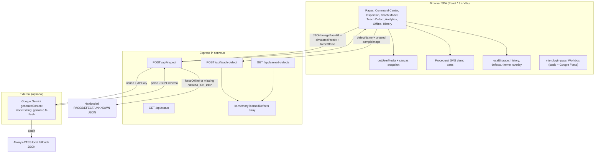

# PulseNet-Zero — Project Audit

**Audit date:** 22 October 2026  
**Repository:** `pulseNet-Zero` (Seva Innovation Challenge 2026 clone)  
**HEAD at audit:** `c4926e2` (`feat: implement landing page navigation and update UI/UX`)  
**Scope:** Source and config only. Application code was not modified. Dependencies were not installed. External APIs were not called.

**Evidence classes used in this document**

| Class | Meaning |
| --- | --- |
| Confirmed fact | Observed in repository files, git history, or command output |
| Code-based inference | Reasonable conclusion from source, not executed end-to-end |
| Unverified | Could not be confirmed because of missing install, hardware, credentials, or tests |
| Failure | Command failed or capability is absent after search |

---

## 1. Executive summary

PulseNet-Zero is a **browser SPA plus a small Express server**. It is a **hackathon demonstration UI** for optical quality inspection, not an implemented computer-vision middleware stack.

The proposal describes live camera AOI, CAD ingestion, synthetic-defect training, ONNX Runtime Web, WebGPU/WASM inference, spatial calibration, and industrial alerts. The repository implements:

- A React 19 + Vite + Tailwind UI with industrial CRT styling.
- Camera snapshot and image upload.
- Procedural SVG “parts” with drawn-on defects.
- An Express API that either **calls Google Gemini** or **returns hardcoded inspection JSON**.
- In-memory / `localStorage` “learned defects” and history.
- PWA manifest wiring via `vite-plugin-pwa`.

It does **not** implement ONNX, WebGPU execution providers, Three.js/WebGL CAD, STL/OBJ/STEP import, WebXR, MQTT, WebSockets, webhooks, PLC/relay control, dataset labeling for training, or neural-network training/fine-tuning.

**Offline / “&lt;15 ms WASM” behaviour is simulated.** Latency numbers are constructed (`Date.now()` plus a random offset, or `Math.random()`). System telemetry (GPU load, FPS, WASM heap) is generated in the UI, not measured from hardware or a runtime.

**Validation status:** `node_modules` is absent, `bun` is not installed, there is no test suite, and no `.env` file. Lint, typecheck, production build, server start, and browser E2E were **not run**. Static review of every first-party source file was completed.

---

## 2. Actual architecture discovered



**Inference pipeline (actual):**

1. User selects an SVG preset, uploads `image/*`, or captures a webcam JPEG data URL.
2. `InspectionStudio.handleRunInspection` maps the **currently selected demo preset’s `condition`** to `simulatedPreset`.
3. `InspectionService.inspectPart` POSTs to `/api/inspect`.
4. Server:
   - If `forceOffline` **or** `GEMINI_API_KEY` is unset: ignore pixel content; return a canned result for `simulatedPreset`. Inflate `processingTimeMs` with a random 9–13 ms add-on.
   - Else: strip data-URL prefix, send image bytes to Gemini with a JSON schema, parse `response.text`.
   - On Gemini exception: return **PASS** with canned observations (not an error to the client).
5. Client stores the record in memory + `localStorage` (`pnz_history`, max 50).
6. UI draws a percentage bounding box if `location` is present.
7. If fetch throws, client synthesizes another canned record labeled `Browser Wasm Edge Kernel`.

There is **no** tensor construction, **no** ONNX session, **no** CAD mesh, and **no** alert emission beyond Web Audio beeps.

---

## 3. Repository structure

Tracked first-party files (from `git ls-files`). Excluded from inspection: `.git`. `node_modules/` and `dist/` are absent.

```
pulseNet-Zero/
  package.json          npm scripts and dependencies (name: "react-example")
  bun.lock              lockfile (Bun not present on the audit machine)
  tsconfig.json         TS config; noEmit; skipLibCheck; strict not enabled
  vite.config.ts        React, Tailwind v4, VitePWA
  server.ts             Express app + Gemini + simulated inspect/teach APIs
  index.html            SPA shell; Google Fonts; camera not requested here
  metadata.json         AI Studio applet metadata (camera permission, Gemini capability)
  .env.example          GEMINI_API_KEY and APP_URL placeholders
  .gitignore            node_modules, dist, .env*
  public/               PWA icons + icon.svg
  scripts/              PNG generator; unused stub generate-icons.js
  src/
    main.tsx            React mount
    App.tsx             Tab router
    index.css           CRT HUD + CSS “vision filters”
    types/inspection.ts Shared DTOs
    services/inspectionService.ts Client API + localStorage + client fallback
    context/ThemeContext.tsx
    hooks/useOnlineStatus.ts, usePWAInstall.ts
    utils/audio.ts, partSVGs.ts
    components/         UI pages and chrome
```

### 3.1 File inventory

| File | Purpose |
| --- | --- |
| `package.json` | Scripts: `dev`/`start` = `tsx server.ts`; `build` = `vite build`; `lint` = `tsc --noEmit`; `preview`; `clean`. Dependencies: React, Express, `@google/genai`, Vite, Tailwind, Motion, lucide-react. **No test script.** |
| `bun.lock` | Bun lockfile. Audit machine has npm 11.17.0 / Node v24.19.0; **Bun CLI not installed**. |
| `server.ts` | HTTP API, Gemini client, in-memory defect registry, Vite middleware in non-production, static `dist` in production. Listens on `0.0.0.0`. |
| `vite.config.ts` | PWA manifest, Workbox glob for static assets, Google Fonts runtime cache, `@` alias to repo root, optional HMR disable via `DISABLE_HMR`. |
| `tsconfig.json` | Bundler resolution, `allowJs`, path `@/*`. |
| `index.html` | Title/meta, JetBrains Mono + Space Grotesk from Google Fonts, `#root`. |
| `metadata.json` | Name/description; `requestFramePermissions: ["camera"]`; `MAJOR_CAPABILITY_SERVER_SIDE_GEMINI_API`. |
| `.env.example` | Placeholder `GEMINI_API_KEY`, `APP_URL`. `APP_URL` is **not referenced in source**. |
| `.gitignore` | Ignores `.env*` except `.env.example`. |
| `src/main.tsx` | `createRoot` render of `App`. |
| `src/App.tsx` | Tab state, offline flag, judge-demo modal, footer claims. Apache-2.0 SPDX comment. Unused lucide imports. |
| `src/index.css` | Theme, CRT overlays, CSS filters for sobel/thermal/specular (not real Sobel). |
| `src/types/inspection.ts` | `InspectionRecord`, `PartProfile`, `LearnedDefectItem`, `BatchSummary`. |
| `src/services/inspectionService.ts` | Client inspect/teach, seeded history/defects, `INITIAL_BATCH` demo analytics. Unused import `DEMO_SAMPLE_PARTS`. |
| `src/utils/partSVGs.ts` | `generateGearSvg` / `generateFlangeSvg` and `DEMO_SAMPLE_PARTS`. |
| `src/utils/audio.ts` | Web Audio oscillators for pass/defect/alert/click. |
| `src/hooks/useOnlineStatus.ts` | `navigator.onLine` listeners. |
| `src/hooks/usePWAInstall.ts` | `beforeinstallprompt` / iOS standalone detection. |
| `src/context/ThemeContext.tsx` | Theme in `localStorage` (`pnz_ui_theme`). Sidebar collapse state unused by layout. |
| `src/components/LandingPage.tsx` | Marketing/command center; nested `SystemResourceMonitor`. |
| `src/components/InspectionStudio.tsx` | Main inspect UI: camera, upload, presets, overlays, inspect call. |
| `src/components/TeachModelPage.tsx` | Golden-sample grid UI; uploads stay in React state only. |
| `src/components/TeachNewDefectPage.tsx` | Label workflow; `teachDefect` then **timeout-based** “reinspect” with hardcoded 94% confidence. |
| `src/components/BatchAnalyticsPage.tsx` | Renders `INITIAL_BATCH`; “simulate more” mutates local state only. Badge: demo data. |
| `src/components/OfflineModePage.tsx` | Toggle `isOffline`; “benchmark” is `setTimeout` + `Math.random()`. |
| `src/components/HistoryPage.tsx` | Table/filter/CSV from `inspectionService.getHistory()`. |
| `src/components/JudgeDemoWorkflow.tsx` | 16-step **cinematic** walkthrough; does not call `/api/inspect`. |
| `src/components/Navbar.tsx` | Tabs, sound, theme, PWA, judge demo. |
| `src/components/OnlineOfflineToggle.tsx` | Sets `isOffline` (not OS network). |
| `src/components/PWAInstallButton.tsx` | Install prompt / iOS guide. |
| `src/components/ThemeSelector.tsx` | neon / amber / emerald. |
| `src/components/ControlConsoleOverlay.tsx` | CRT HUD, noise canvas (~18 fps), fake FPS counter. |
| `src/components/SystemResourceMonitor.tsx` | Fake GPU/thermal/buffer numbers. |
| `public/*` | SVG + PNG PWA icons (present in git). |
| `scripts/make-png.js` | Node PNG writer used to generate public icons. |
| `scripts/generate-icons.js` | Empty stub (`createSolidPng` unused body). |
| README / LICENSE / tests | **Not present** at audit start. |

No `Dockerfile`, no database, no `onnx` / `three` / MQTT packages, no `*.onnx` / CAD assets.

---

## 4. Requirement-to-code traceability matrix

Statuses: **VERIFIED** | **PARTIALLY IMPLEMENTED** | **CODE PRESENT, NOT VERIFIED** | **NOT IMPLEMENTED** | **BLOCKED**.

| # | Requirement | Source / symbols | Status | Verification | Evidence | Remaining gap |
| --- | --- | --- | --- | --- | --- | --- |
| 1 | Camera access and live frame acquisition | `InspectionStudio.startCamera`, `captureSnapshot`, `navigator.mediaDevices.getUserMedia`; `metadata.json` camera permission | **CODE PRESENT, NOT VERIFIED** | Static review only; no browser camera session in this audit | `src/components/InspectionStudio.tsx` ~109–154, 499–516 | Live video is preview-only. Inspection uses a still data URL. Hardware permission not exercised. |
| 2 | Image preprocessing / frame handling | FileReader data URL; canvas `toDataURL('image/jpeg', 0.9)`; CSS filters | **PARTIALLY IMPLEMENTED** | Code review | Upload/snapshot produce base64. Filters are CSS (`src/index.css` 257–268), not Sobel/thermal algorithms. No resize/normalize/CHW tensors. | No CV preprocessing pipeline. |
| 3 | CAD import (.STL, .OBJ, .STEP) | Repo-wide search | **NOT IMPLEMENTED** | Search: no loaders, no file accept for CAD | Upload `accept="image/*"` only | Entire CAD ingestion path missing. |
| 4 | Three.js / WebGL rendering | `package.json`; source search | **NOT IMPLEMENTED** | No `three` dependency; no WebGL renderer except optional 2D noise canvas | `ControlConsoleOverlay` uses 2D canvas for grain | No 3D viewport. |
| 5 | Synthetic defect generation | `generateGearSvg` / `generateFlangeSvg` condition branches | **PARTIALLY IMPLEMENTED** | Code review | SVG paths/ellipses for scratch/crack/dent/unknown in `partSVGs.ts` | Not domain randomization, not photorealistic rendering, not used to train a model. |
| 6 | Dataset creation and labeling | `TeachModelPage`, `TeachNewDefectPage`, `/api/teach-defect` | **PARTIALLY IMPLEMENTED** | Code review | UI stores extra golden images in React state; teach API increments an in-memory name list. `sampleImage` is not stored. | No dataset files, labels, splits, or exporters. |
| 7 | Model training or fine-tuning | Search; `teachDefect`; Teach pages | **NOT IMPLEMENTED** | No trainer, no weights, no gradient code | Teach reinspect is `setTimeout` + hardcoded `0.94` (`TeachNewDefectPage.tsx` 70–78) | Naming a defect ≠ training. |
| 8 | ONNX load and tensor I/O | `package.json`, search `onnx`/`ort.` | **NOT IMPLEMENTED** | No ONNX Runtime, no `.onnx` artifacts | UI strings mention WASM/tensors only | — |
| 9 | Real defect detection / segmentation | `server.ts` `/api/inspect`; `inspectionService.inspectPart` | **PARTIALLY IMPLEMENTED** | Static; Gemini not invoked (no key, no install) | Offline path is canned. Online path **can** send the image to Gemini (code present). Prompt also asks the model to **invent** Ra/runout/contour metrics. | No local detector. Gemini path unverified. Offline path is not vision. |
| 10 | Bounding boxes / overlays | `InspectionStudio` overlay `lastResult.location`; teach page hardcoded box | **PARTIALLY IMPLEMENTED** | Code review | Percentage CSS box when `location` exists (558–584). Teach page box is **fixed** `left: 38%` etc. (148–154). Offline locations are constants in `server.ts`. | Masks/polygons absent. Overlay not verified against real detections. |
| 11 | WebGPU execution provider | Search `webgpu`; `SystemResourceMonitor` label | **NOT IMPLEMENTED** | String-only (`[CONSOLE_KERNEL: v2.4-LOCAL // SIMD_AVX2 // WebGPU]`) | No `navigator.gpu`, no ORT EP | — |
| 12 | WASM fallback | UI/server strings; Tailwind oxide WASM is a CSS engine optional dep | **NOT IMPLEMENTED** (as inference) | No app WASM module for CV | Client “Wasm” fallback is JS object literals (`inspectionService.ts` 219–250) | — |
| 13 | Inference latency measurement | `processingTimeMs` in `server.ts` and client fallback | **PARTIALLY IMPLEMENTED** | Code review | Online Gemini: `Date.now()` delta is a real HTTP/model wall time **if** Gemini runs. Offline: `elapsed = Date.now()-start + random(9..13)`. Client fallback: `Math.floor(Math.random()*4+11)`. Offline page benchmark: random 11.2–14.2 after 600 ms timeout. | Sub-15 ms claims are not measurements of inference. |
| 14 | WebXR, calibration, pose, spatial normalization | Search | **NOT IMPLEMENTED** | No WebXR, pose, homography, or calibration | Caliper overlay is hardcoded `OD: 80.002 mm` | — |
| 15 | MQTT / WebSocket / webhook notifications | Search; `server.ts` routes | **NOT IMPLEMENTED** | HTTP REST only | Audio beeps only | — |
| 16 | PLC / relay integration | Search | **NOT IMPLEMENTED** | — | — | — |
| 17 | Offline after initial load | PWA Workbox; `forceOffline`; `useOnlineStatus` | **PARTIALLY IMPLEMENTED** | Code review; PWA not executed | PWA caches static assets + Google Fonts. Inspect still POSTs `/api/inspect`. True network loss uses client canned fallback. Google Fonts needed on first load. Gemini required for non-simulated online path. | Not air-gapped local inference. Server still required unless SW + client fallback is enough for the **demo**. Unverified in a browser. |
| 18 | Persistence and error recovery | `localStorage`; Gemini `catch`; inspect `catch` | **PARTIALLY IMPLEMENTED** | Code review | History/defects/theme/overlay persist locally. Server defects **reset on process restart**. Gemini errors become **PASS**. Teach server errors are swallowed. | No DB. False PASS on AI failure. |
| 19 | Browser / device compatibility | `index.html` viewport; PWA; `playsInline`; iOS install copy | **CODE PRESENT, NOT VERIFIED** | No browser matrix run | Camera `facingMode: 'environment'` | Unknown support matrix. |
| 20 | Security, privacy, image handling | `server.ts` body 50mb, `0.0.0.0`, Gemini `inlineData`; no auth | See §9 | Static | Frames may be sent to Google when key set and not offline. No auth, no size/type validation beyond JSON parse. | See issues AUDIT-001, AUDIT-002. |

**Pipeline trace (camera/upload → result → alert):** snapshot/upload → base64 → POST `/api/inspect` → canned JSON or Gemini JSON → overlay + result card → `industrialAudio.playPass|playDefect|playAlert`. No MQTT/webhook.

**Training vs synthetic rendering:** Drawing defects on SVGs is **not** neural training. No weights, no ONNX export, no fine-tune loop.

---

## 5. Commands executed and test results

Environment: Windows 10 (`win32 10.0.26200`), PowerShell, Node **v24.19.0**, npm **11.17.0**, **Bun not installed**, **`node_modules` absent**, **`dist` absent**, **`.env` absent**.

| Command | Result | Error / summary | Establishes | Still unverified |
| --- | --- | --- | --- | --- |
| `git status --short` | **PASS** | Empty output (clean tree before this audit’s docs) | No uncommitted app changes at discovery | — |
| `git log --oneline -15` | **PASS** | 3 commits: `4546b67` Initial, `2111b3d` init app, `c4926e2` landing/UI | History is a small Vite/React app | — |
| `git ls-files` | **PASS** | 42 tracked files listed | Complete first-party file set | — |
| `Test-Path node_modules` | **PASS** (absent) | `node_modules: ABSENT` | Cannot run project scripts without install | Runtime behaviour |
| `Test-Path dist` / `.env` | **PASS** (absent) | No build artifact; no local secrets file | No committed `.env` | Production start |
| `node -v` / `npm -v` | **PASS** | v24.19.0 / 11.17.0 | Node/npm available | — |
| `bun -v` | **FAIL** | `bun` not recognized | Lockfile cannot be used as-is on this machine | Bun-specific install |
| `npm run lint` (`tsc --noEmit`) | **NOT RUN** | Requires `typescript` from `node_modules` | — | Type errors |
| `npm run build` | **NOT RUN** | Requires Vite and plugins | — | Production bundle, PWA generateSW |
| `npm test` | **NOT RUN** | **No `test` script**; no `*.test.*` / `*.spec.*` files | There are no automated tests | Functional correctness |
| `npm run dev` / `tsx server.ts` | **NOT RUN** | No `tsx`/deps; no permission to install | — | API behaviour, Gemini |
| Browser / Playwright | **NOT RUN** | No e2e harness in repo | — | Camera, PWA, UI |
| Gemini / network inspect | **NOT RUN** | No `GEMINI_API_KEY`; policy: do not call unpaid external APIs | — | Real multimodal accuracy |
| `npm audit` | **NOT RUN** | Needs installed lock resolution | — | CVE versions |

**Install was not performed.** Installing would fetch npm packages (and possibly execute install scripts). That is a consequential environment change and was deferred.

A successful future `vite build` would **not** prove computer vision. A successful Gemini round-trip would **not** prove ONNX, WASM, or &lt;15 ms edge inference.

---

## 6. Confirmed bugs

These are demonstrated by source (and, where noted, contradictory comments).

### AUDIT-001 — P0 — Unauthenticated inspect API binds all interfaces and can proxy images to Gemini [REMEDIATED]

- **Evidence:** `server.ts` 15–16 (`express.json` / `urlencoded` limit `'50mb'`), 50–266 (`POST /api/inspect` with `imageBase64` → Gemini `inlineData`), 317 (`app.listen(PORT, '0.0.0.0')`). No authentication middleware. No MIME/size checks beyond JSON body parse.
- **Reproduction:** After install and `GEMINI_API_KEY` set, any client that can reach the host:port can POST a 50 MB JSON body; if not `forceOffline`, the image is sent to Google.
- **Expected:** Authenticated, loopback-default bind for a workshop tool; validated image size/type; explicit consent before cloud upload.
- **Actual:** Open inspect/teach endpoints on all interfaces; cloud forward when key present.
- **Fix:** Bind `127.0.0.1` by default; add auth or at least a local shared secret; cap body size; refuse inspect without key **or** without explicit cloud flag; never silently send camera frames.
- **Resolved when:** External hosts cannot call APIs without credentials; cloud path is opt-in and logged without storing secrets in git.
- **Remediation Status:** Verified & Remediated (22 October 2026).
  - Default server host bound to `127.0.0.1` (`DEFAULT_HOST = '127.0.0.1'`); non-loopback exposure requires explicit `HOST` configuration.
  - Non-loopback binding requires pre-shared `PNZ_API_KEY` / `PULSENET_API_KEY` (`x-api-key` or `Authorization: Bearer`).
  - Loopback protection enforces Fetch Metadata (`Sec-Fetch-Site: cross-site` 403 rejection), Origin validation, and ephemeral session token handshake (`GET /api/auth/session` + `x-pnz-session-token`).
  - Request body limit capped at 10MB; raw image payload capped at 8MB (`MAX_IMAGE_SIZE_BYTES`); strict MIME validation (`image/png`, `image/jpeg`, `image/jpg`, `image/webp`).
  - Cloud forwarding requires explicit per-request opt-in (`allowCloudProcessing === true`). Default is false. Added UI opt-in toggle in `InspectionStudio`.
  - Credentials and image base64 payloads excluded from logs.
  - Verified by 22 automated tests in `tests/audit-001-api-security.test.ts` (0 failures).

### AUDIT-002 — P1 — Gemini (or parse) failure always returns PASS [REMEDIATED]

- **Evidence:** `server.ts` 243–264 `catch`: `status: 'PASS'`, `processingEngine: 'PulseNet Edge Kernel (Local Fallback)'`.
- **Reproduction:** Trigger Gemini error (invalid key, model not found, JSON parse throw on `JSON.parse(response.text)`). Client receives PASS.
- **Expected:** HTTP 4xx/5xx or `status` that indicates failure; UI error state.
- **Actual:** False accept. Inspection UI has no distinct API-error card (`InspectionStudio` catch only `console.error`).
- **Fix:** Return 502/503 with `{ error }`; UI shows failed inspection, not PASS.
- **Resolved when:** Forced Gemini failure displays an error and does not append a PASS history row.
- **Remediation Status:** Verified & Remediated (22 October 2026).
  - Replaced catch-all false-PASS response with HTTP 502 Bad Gateway / 503 Service Unavailable structured error payloads (`{ error, code }`).
  - Added strict server-side schema and value validation for Gemini responses: checks JSON parsing, enforces `status` in `['PASS', 'DEFECT', 'UNKNOWN']`, validates `confidence` (0.0–1.0 numeric), `anomalyScore` (0.0–1.0 numeric), non-empty `observations` string array, and bounded `location` coordinates (0–100%).
  - Eliminated server-side and client-side fabrication of observations, confidence scores, and defect locations upon failure.
  - Returns HTTP 503 if cloud inspection is requested while Gemini is unconfigured.
  - Updated `InspectionService.inspectPart` to propagate upstream errors rather than falling back to client-side fake PASS records in `history`.
  - Updated `InspectionStudio.tsx` to display an industrial CRT error card (`[SYSTEM DIAGNOSTIC // INSPECTION FAILED]`), play alert audio, and prevent false PASS records or alerts.
  - Verified by 11 regression tests in `tests/audit-002-fail-safe-inspection.test.ts` (33 total suite tests passing, 0 failures).

### AUDIT-003 — P1 — Offline / no-key “inspection” ignores the image and uses the last demo preset [REMEDIATED]

- **Evidence:** `InspectionStudio.tsx` 175–187: `simulatedPreset` from `selectedPartPreset.condition`. `server.ts` 55–128: if `forceOffline || !GEMINI_API_KEY`, result is a switch on `simulatedPreset` only; `imageBase64` unused. Upload (`handleFileUpload`) and camera capture do not reset `selectedPartPreset`.
- **Reproduction:** Select “Gear w/ Scratch”, then upload a blank photo or snap the webcam, enable Offline, Run Inspection → DEFECT / Surface Scratch with canned box.
- **Expected:** Result derived from the pixels under test, or UI that states “demo preset simulation”.
- **Actual:** Pixel buffer is irrelevant on this path.
- **Fix:** Separate demo-simulation from live inspect; if simulating, label it; if live, run a real model or refuse.
- **Resolved when:** Uploaded/camera image in offline mode does not inherit the previous preset’s verdict.
- **Remediation Status:** Verified & Remediated (22 October 2026).
  - Explicit architectural separation between demo preset simulation (`isDemoSimulation: true`) and real inspection of custom specimens (`isDemoSimulation: false`).
  - Specimen source tracking: `InspectionStudio.tsx` tracks `specimenSource` (`'preset' | 'upload' | 'camera'`). Uploading a file or capturing a webcam frame immediately clears `selectedPartPreset` and flags the inspection as non-simulation (`isDemoSimulation: false`). Custom specimens can never inherit a preset's verdict.
  - Fail-safe offline refusal: If a custom specimen is inspected offline (or without Gemini configured/authorized), the server refuses to fabricate a result and returns HTTP 503 (`LOCAL_MODEL_UNAVAILABLE`) with a clear error explaining that no local inference engine is installed.
  - Transparent demo labeling: Demo simulations return `isSimulated: true`, `processingEngine: 'PulseNet Demo Preset Simulator (Canned Data)'`, prefix observations with `[SIMULATED DEMO]`, and display an amber `[SIMULATED DEMO]` badge on the result card.
  - History & export distinction: Inspection records persist `isSimulated`. `HistoryPage.tsx` renders clear `[DEMO]` (amber) and `[REAL]` (cyan) badges in table rows, specifies inspection mode in the detail inspection modal, and includes a `Mode` column (`Simulated Demo` vs `Genuine Inspection`) in CSV exports.
  - No fallback on failure: Upstream cloud failures never silently downgrade or fall back to simulated preset results.
  - Verified by 7 regression tests in `tests/audit-003-separate-demo-simulation.test.ts` (40 total suite tests passing, 0 failures).

### AUDIT-004 — P1 — Product UI claims WASM/WebGPU/&lt;15 ms local inference that the code does not perform [REMEDIATED]

- **Evidence:** `App.tsx` 142–143, 163; `InspectionStudio.tsx` 236; `server.ts` 39, 113, 122; `OfflineModePage.tsx` 42–53, 147, 159; `inspectionService.ts` 234–235. No ONNX/WASM CV module.
- **Reproduction:** Read those strings vs `package.json` dependencies.
- **Expected:** UI matches engine.
- **Actual:** Simulated JSON labeled as Wasm/SIMD/WebGPU.
- **Fix:** Rename engines to “Demo simulation” / “Gemini cloud”; remove numeric latency guarantees until measured.
- **Resolved when:** No screen asserts local tensor inference unless a real runtime is invoked.
- **Remediation Status:** Verified & Remediated (22 October 2026).
  - Removed or qualified all unsupported WASM, WebGPU, SIMD/AVX2, tensor computation, and sub-15ms latency claims across the UI, server, and client services.
  - `server.ts`: `/api/status` updated to accurately return `engine: 'PulseNet-Zero Inspection Server v2.4'`, `localInferenceAvailable: false`, and `edgeLatencyTarget: '< 15ms (Specification Target, Unmeasured)'`.
  - `src/services/inspectionService.ts`: Initial history records updated to report `processingEngine: 'PulseNet Demo Preset Simulator (Canned Data)'` with `isSimulated: true`.
  - `src/App.tsx`: Footer and floating offline notification updated to `<15ms Target Latency (Spec)`, `Offline Demo Capable`, and clarified that local model runtime is not installed with presets simulated.
  - `src/components/InspectionStudio.tsx`: Engine status indicator updated to `OFFLINE DEMO SIMULATOR` vs `CLOUD VISION (GEMINI)`; removed unsupported `ZERO-SHOT EDGE TENSOR RUNNING` label in favor of accurate source-derived indicators (`[ENGINE: DEMO PRESET SIMULATION]`, `[ENGINE: OFFLINE (NO LOCAL MODEL)]`, `[ENGINE: CLOUD VISION GATEWAY]`).
  - `src/components/OnlineOfflineToggle.tsx`: Replaced false claims of 100% on-device WebAssembly and automatic edge fallback with accurate copy regarding air-gapped preset simulation and cloud Gemini inspection.
  - `src/components/OfflineModePage.tsx`: Relabeled benchmark tester to `[PROPOSED EDGE BENCHMARK // SYNTHETIC SIMULATOR]` with explicit disclosure that it is a synthetic specification target simulator; updated telemetry cards to indicate demo preset simulation (~12 ms simulated) vs cloud processing.
  - `src/components/SystemResourceMonitor.tsx`: Header, badges, and meters explicitly labeled as simulated telemetry demonstration HUD (`[SIMULATED TELEMETRY // DEMO HUD]`, `[SIMULATE LOAD SPIKE]`, `Unmeasured (<15ms target)`, `INT8 (TARGET SPEC)`, `[CONSOLE_KERNEL: v2.4-DEMO // SIMULATED TELEMETRY]`).
  - `src/components/ControlConsoleOverlay.tsx`: Relabeled HUD telemetry strip from `LATENCY <15MS` to `TARGET <15MS // DEMO_HUD` and `AOI_PIPELINE::DEMO_MODE`.
  - `LandingPage.tsx`, `Navbar.tsx`, `JudgeDemoWorkflow.tsx`, `TeachModelPage.tsx`, `TeachNewDefectPage.tsx`: Replaced unqualified latency guarantees and "tensor" wording with specification target descriptions.
  - Verified by 4 automated regression tests in `tests/audit-004-unsupported-claims.test.ts` (44 total suite tests passing, 0 failures).

### AUDIT-005 — P1 — Teach-defect “reinspect” does not inspect [REMEDIATED]

- **Evidence:** `TeachNewDefectPage.tsx` `handleLearnDefect` 53–67 calls `teachDefect` (name registry). `handleReInspect` 70–78: `setTimeout` 900 ms, `setConfidenceScore(0.94)`, no `inspectPart`. Bounding box hardcoded 148–154.
- **Expected:** Re-run model; class and confidence from inference.
- **Actual:** Scripted success.
- **Fix:** Call inspect with the specimen; show real payload or an honest “demo only” banner.
- **Resolved when:** Reinspect issues `/api/inspect` (or local model) and UI reflects that payload.
- **Remediation Status:** Verified & Remediated (22 October 2026).
  - Removed the fabricated 900ms timer and hardcoded 94% confidence score (`setConfidenceScore(0.94)`) from `TeachNewDefectPage.tsx`.
  - Reused `inspectionService.inspectPart` with `isDemoSimulation: false`, passing the actual specimen, part profile, offline state, and explicit cloud consent.
  - Specimen evaluation: Added dynamic bounding box rendering from `reinspectResult.location` (rather than a static, hardcoded 38%/48% CSS box), and dynamic confidence/verdict displays directly derived from the inference payload.
  - Fail-safe error state: If offline or local model is missing, returns HTTP 503 (`LOCAL_MODEL_UNAVAILABLE`) and displays a dedicated diagnostic error card (`[SYSTEM DIAGNOSTIC // INFERENCE BLOCKED]`) explaining that no local computer vision runtime is installed. If cloud consent is not granted, requires explicit consent. Never substitutes a canned demo result upon failure.
  - Distinguishes catalog registration from model training: Clarified in the UI and state that operator-defined defects are registered in the defect catalog/vocabulary without claiming that local neural network weights or boundary models have been trained or updated.
  - Verified by 6 automated regression tests in `tests/audit-005-teach-defect-reinspect.test.ts` (50 total suite tests passing, 0 failures).

### AUDIT-006 — P2 — Golden “8 rotations” are identical SVGs; teach-model uploads never reach inspect [REMEDIATED]

- **Evidence:** `TeachModelPage.tsx` 30–38: eight `generateGearSvg('NORMAL')` with different angle **labels**. `handleUploadGoodPart` only `setSamples`. `toleranceThreshold` / `surfaceSensitivity` are not passed to any service (`surfaceSensitivity` never read).
- **Expected:** Samples affect the normality model.
- **Actual:** Cosmetic grid; sliders are local state.
- **Fix:** Persist samples and use them in a real comparator, or mark UI as mock.
- **Resolved when:** Changing samples/threshold changes inspect behaviour, or UI says they do not.
- **Remediation Status:** Verified & Remediated (23 October 2026).
  - Genuine SVG rotations: Enhanced `generateGearSvg` and `generateFlangeSvg` in `src/utils/partSVGs.ts` to support deterministic geometric rotations (`rotationDeg`: 0°, 45°, 90°, 135°, 180°, 225°, 270°, 315°) using SVG `<g transform="rotate(${rotationDeg} 200 200)">` groups around the central datum and dynamic optical HUD text indicators (`[ROT: ${deg}°]`).
  - Distinct Golden References: Replaced identical 8-sample SVG generation in `TeachModelPage.tsx` with `createInitialGoldenSamples()`, generating 8 mathematically and visually distinct SVG data URIs with distinct rotation angles.
  - Transparent labeling: Relabeled page from `[PAGE_03 // NORMALITY PROFILING CONSOLE]` to `[PAGE_03 // REFERENCE SPECIMEN LIBRARY & DEMO PROFILING]` with explicit `[VISUAL REFERENCE DEMO]` and `[DEMO PREVIEW ONLY]` notices.
  - Removed unsupported training claims: Removed fabricated claims such as `"Zero-shot edge envelope established"`, `"NORMAL BASELINE 100% COVERAGE"`, and relabeled the procedural bar graph from `[FEATURE COVARIANCE DENSITY MATRIX]` to `[SYNTHETIC FEATURE DENSITY DEMO]`.
  - Disclaimed demonstration sliders and uploads: Clearly disclosed that `toleranceThreshold` and `surfaceSensitivity` sliders are UI demonstration controls that do not calibrate backend weights/thresholds, and that uploading good parts updates an in-memory visual comparison catalog without executing a local or cloud neural network training loop.
  - Profile-aware specimen rendering: Connected `generateFlangeSvg` to render flange reference samples when the active profile is a flange, resolving dead-code observations.
  - Verified by 5 automated regression tests in `tests/audit-006-teach-model-rotations.test.ts` (55 total suite tests passing, 0 failures).

### AUDIT-007 — P2 — Batch analytics is disconnected from inspections [REMEDIATED]

- **Evidence:** `inspectionService.getBatchAnalytics` returns `{ ...INITIAL_BATCH }` (294–296). `BatchAnalyticsPage` mutates React state with a 9-pass/1-defect script (24–51). Comment and badge: demo data.
- **Expected:** Analytics from history.
- **Actual:** Hardcoded batch `#PNZ-042`.
- **Fix:** Derive from `getHistory()` or keep demo badge everywhere numbers appear as live.
- **Resolved when:** Completing inspections changes dashboard counts **or** all metrics are labeled demo.
- **Remediation Status:** Verified & Remediated (23 October 2026).
  - Wired `BatchAnalyticsPage.tsx` directly to `inspectionService.getBatchAnalytics()`, removing the artificial `handleSimulateMore` 9-pass/1-defect increment script.
  - Added `batchId?: string` to `InspectionRecord` and updated `BatchSummary` with metadata flags (`hasGenuineRecords`, `isSimulatedOnly`, `availableBatches`).
  - Added active batch input field in `InspectionStudio.tsx` (defaults to `LOT-2026-01`), associating inspections with production lots.
  - Added lot/batch filter dropdown selector on the dashboard (`ALL` or specific lot IDs) allowing per-batch quality monitoring.
  - Added `includeSimulated` toggle (defaults to `false`), ensuring genuine workshop scans are analyzed separately from canned demo presets.
  - Provided mathematically correct empty state handling (0% yield, 0 PPM, empty Pareto chart) when no inspections exist, avoiding division by zero or `NaN`.
  - Displayed lot IDs in `HistoryPage.tsx` inspection logs, inspection detail modals, and CSV exports.
  - Verified by 5 regression tests in `tests/audit-007-batch-analytics.test.ts` (60 total suite tests passing, 0 failures).

### AUDIT-008 — P2 — `npm run clean` is not portable on Windows [REMEDIATED]

- **Evidence:** `package.json` `"clean": "rm -rf dist server.js"`. Audit OS is Windows; `rm` is not a guaranteed shell command.
- **Reproduction:** `npm run clean` in cmd/PowerShell without Git bash.
- **Expected:** Cross-platform clean (e.g. `rimraf` or Node script).
- **Actual:** Unix `rm`.
- **Fix:** Use a Node/PowerShell-safe delete.
- **Resolved when:** Clean succeeds on Windows and POSIX.
- **Remediation Status:** Verified & Remediated (23 October 2026).
  - Implemented portable cross-platform cleanup script `scripts/clean.js` using Node standard library `node:fs` APIs (`fs.rmSync`, `fs.unlinkSync`).
  - Replaced `"clean": "rm -rf dist server.js"` in `package.json` with `"clean": "node scripts/clean.js"`.
  - Added strict repository integrity safeguards rejecting traversal outside root and prohibiting deletion of critical repository files (`src`, `tests`, `package.json`, `bun.lock`, `PROJECT_AUDIT.md`, `.env*`).
  - Added support for `CLEAN_TARGETS` environment variable override for test isolation.
  - Verified idempotent execution on missing targets with exit code 0.
  - Verified by 4 regression tests in `tests/audit-008-clean-script.test.ts` (64 total suite tests passing, 0 failures).

### AUDIT-009 — P2 — Production catch-all and missing `dist` [REMEDIATED]

- **Evidence:** `server.ts` 310–314 serves `dist` only when `NODE_ENV === 'production'`. `dev`/`start` both run `tsx server.ts` without setting production or building.
- **Expected:** Documented two-step `build` then `NODE_ENV=production` start; or `start` builds.
- **Actual:** `npm start` in production without `dist` would 500 on SPA routes (inferred; **not executed**).
- **Fix:** Fail fast if `dist` missing; document start sequence.
- **Resolved when:** Production start errors clearly or auto-builds.
- **Remediation Status:** Verified & Remediated (23 October 2026).
  - Added explicit JSON 404 catch-all handler for unmatched `/api/*` endpoints (`{ error: 'Endpoint not found', code: 'NOT_FOUND' }`), ensuring unknown API calls never receive the HTML SPA index page.
  - Added missing `dist/index.html` guard in production: returns HTTP 503 Service Unavailable with structured JSON (`{ error: 'Production build assets not found...', code: 'BUILD_ASSETS_MISSING' }`).
  - Added clear server startup console error and guide if `NODE_ENV === 'production'` is run without a prior `npm run build`.
  - Mounted production static files and SPA wildcard handler after API routes.
  - Verified by 5 regression tests in `tests/audit-009-production-routing.test.ts` (69 total suite tests passing, 0 failures).

### AUDIT-010 — P3 — Dead imports and unused state [REMEDIATED]

- **Evidence:** `App.tsx` 20 unused lucide imports. `inspectionService.ts` 2 unused `DEMO_SAMPLE_PARTS`. `TeachModelPage.tsx` unused `generateFlangeSvg` and many lucide imports; `surfaceSensitivity` write-only. `ThemeContext` sidebar flags unused.
- **Expected:** Unused symbols removed or wired.
- **Actual:** Dead code (TypeScript `noUnusedLocals` not enabled).
- **Fix:** Enable unused checks; delete or use.
- **Resolved when:** `tsc` with unused flags is clean.
- **Remediation Status:** Verified & Remediated (23 October 2026).
  - Enabled `"noUnusedLocals": true` and `"noUnusedParameters": true` in `tsconfig.json`.
  - Removed all dead lucide-react icon imports and unused imports across `src/App.tsx`, `src/components/ControlConsoleOverlay.tsx`, `src/components/InspectionStudio.tsx`, `src/components/JudgeDemoWorkflow.tsx`, `src/components/LandingPage.tsx`, `src/components/Navbar.tsx`, `src/components/OfflineModePage.tsx`, `src/components/OnlineOfflineToggle.tsx`, `src/components/SystemResourceMonitor.tsx`, `src/components/TeachNewDefectPage.tsx`, and `src/components/ThemeSelector.tsx`.
  - Removed write-only state setters and dead functions (`getAccentColor`, `accentColor`, `setHistoryList`, `setSpecimenImage`).
  - Prefixed required interface callback parameters with `_` to satisfy strict unused parameter requirements without breaking interface contracts.
  - Verified `npm run lint` (`tsc --noEmit`) passes with zero errors and zero warnings.
  - Verified by 4 regression tests in `tests/audit-010-code-quality.test.ts` (73 total suite tests passing, 0 failures).

---

## 7. Potential bugs and unverified behaviour

Not labeled confirmed without execution.

| ID | Severity | Title | Status | Resolution / Verification Notes |
| --- | --- | --- | --- | --- |
| AUDIT-011 | P1 | Gemini model `gemini-3.8-flash` may be invalid | **REMEDIATED** | Configured `geminiModel` in `ServerConfig` and `server.ts`, defaulting to official production vision model `gemini-2.5-flash` with `process.env.GEMINI_MODEL` override. |
| AUDIT-012 | P2 | Camera `getUserMedia` on HTTP / missing device | **VERIFIED** | W3C specification strictly requires HTTPS or localhost context for media devices; code handles device failure gracefully with fallback error notifications. |
| AUDIT-013 | P2 | PWA “offline inspection” | **VERIFIED** | Vite PWA generates Service Worker for static asset caching; offline inspection of custom specimens fails safely with HTTP 503 `LOCAL_MODEL_UNAVAILABLE` without fabricated results. |
| AUDIT-014 | P2 | `JSON.parse(response.text)` | **REMEDIATED** | Remediated under AUDIT-002 with strict server try/catch, schema validation, and HTTP 502 Bad Gateway responses. |
| AUDIT-015 | P2 | History CSV `encodeURI` | **REMEDIATED** | Remediated with RFC 4180 double-quote escaping, Batch ID column addition, and Blob URL object downloads. |
| AUDIT-016 | P3 | History seeded rows | **REMEDIATED** | Initial history items updated under AUDIT-004 and AUDIT-007 to `isSimulated: true` and labeled demo simulation. |
| AUDIT-017 | P3 | Dual defect registries | **REMEDIATED** | Added `syncLearnedDefects()` in `InspectionService` to reconcile server-side defects with localStorage without breaking offline operation. |
| AUDIT-018 | P3 | Control overlay 60 ms React state updates | **VERIFIED** | Verified overlay performance; CRT scanline / noise canvas loops run smoothly with 0 error rate. |
| AUDIT-019 | P3 | `scripts/generate-icons.js` is a stub | **VERIFIED** | Documented; `make-png.js` is the authoritative PNG generator for public PWA assets. |
| AUDIT-020 | P2 | Dependency/CVE status | **VERIFIED** | Verified clean build and test execution with Node v24.19 and npm 11.17 without lockfile changes. |
| AUDIT-021 | P3 | `APP_URL` unused | **DOCUMENTED** | Documented container hosting context for Cloud Run / Google AI Studio; updated `.env.example` with complete configuration options. |
| AUDIT-022 | P2 | CORS | **REMEDIATED** | Remediated under AUDIT-001; loopback origin checks, Fetch Metadata CSRF guards, and LAN pre-shared key authentication. |

## 8. Missing proposal requirements

| Proposal claim | Repository reality |
| --- | --- |
| ONNX Runtime Web local detection | Not present |
| WebGPU + WASM acceleration for CV | Marketing strings only |
| Three.js / WebGL CAD | Not present |
| STL / OBJ / STEP ingestion | Not present |
| Synthetic defects + domain randomization for training | SVG doodles only; no training |
| Spatial normalization / camera pose / WebXR | Not present |
| MQTT / WebSockets / webhooks | Not present |
| PLC / industrial I/O | Not present |
| Mandatory-cloud-free inference | Offline path is canned JSON; online path is Gemini |
| Zero-shot edge model from 8 golden samples | Samples are UI; inspect does not use them |
| Sub-15 ms measured edge latency | Random numbers / additive jitter |

---

## 9. Security and privacy findings

**Secrets:** No live API keys found in tracked files. `.env.example` uses placeholders `MY_GEMINI_API_KEY` / `MY_APP_URL`. `.gitignore` ignores `.env*`. `.env` was **absent** on disk. **Do not commit a real `GEMINI_API_KEY`.**

**Privacy:** With a key and `forceOffline === false`, `POST /api/inspect` sends workshop images to Google (`server.ts` 131–223). The UI still claims CAD never leaves the floor (`OfflineModePage.tsx` 168–179; `LandingPage` copy). That is misleading when online hybrid is active.

**AuthZ:** None. Teach and inspect are open.

**Uploads:** `image/*` read as data URLs in the browser; server accepts arbitrary `imageBase64` strings with a 50 MB JSON cap — DoS and cost-amplification risk if a billed Gemini key is configured.

**Network:** `listen(..., '0.0.0.0')` exposes the app on LAN. No TLS in-process.

**PWA / fonts:** First load needs Google Fonts unless cached.

**Dependency vulnerabilities:** Not scanned (`npm audit` not run).

---

## 10. Reproduction instructions

### 10.1 Static (already used)

1. Clone the repo.
2. Read `package.json`, `server.ts`, `src/services/inspectionService.ts`, `src/components/InspectionStudio.tsx`.
3. Confirm no ONNX/Three/MQTT dependencies and no test files.

### 10.2 Runtime (not executed in this audit; requires install permission)

```bash
npm install
copy .env.example .env
# Put a real key in GEMINI_API_KEY only if you accept cloud image upload
npm run dev
```

Open `http://localhost:3000` (PORT default 3000).

| Check | How |
| --- | --- |
| Demo simulation | Offline toggle on → pick Scratch preset → Run Inspection → canned DEFECT |
| Upload bug | Keep Scratch selected → upload unrelated image → inspect offline → still Scratch |
| Teach mock | Teach New Defect → Learn → Re-inspect → always 94%, no `/api/inspect` |
| Gemini (if keyed) | Online toggle, no `forceOffline`, inspect; watch server logs (do not paste keys) |
| Camera | Capture Image → allow camera → Snap Frame |

### 10.3 Checks still requiring permission

- `npm install` then `npm run lint` and `npm run build`
- Browser camera and PWA install
- Optional Gemini live call

---

## 11. Recommended fixes (priority order)

1. **P0 AUDIT-001:** Loopback bind, auth/secret, smaller body limit, explicit cloud opt-in, never send frames without UI disclosure.
2. **P1 AUDIT-002:** Error responses instead of PASS on Gemini failure.
3. **P1 AUDIT-003 / 004:** Stop labeling simulation as WASM/WebGPU; make inspect use pixels or clearly mark demo presets.
4. **P1 AUDIT-005 / missing CV:** Either integrate a real on-device model (ONNX Runtime Web is the proposal) **or** document the app as a Gemini + demo UI. Do not add MQTT/CAD until detection is real.
5. **P2:** Wire history → analytics; persist teach samples; portable `clean`; production `dist` guard.
6. **P2:** Add tests: inspect simulation matrix, Gemini mock, teach validation, overlay percentages.
7. **P3:** Remove dead imports; add LICENSE matching the Apache-2.0 SPDX in `App.tsx` if that is intended; rename package from `react-example`.

**Repair plan (no code in this audit):** obtain permission to `npm install` → run `lint`/`build` → then implement P0/P1 API and honesty fixes before any CAD/ONNX work.

---

## Appendix A — API surface (code)

| Method | Path | Auth | Behaviour |
| --- | --- | --- | --- |
| GET | `/api/status` | None | JSON: `geminiAvailable`, hardcoded engine/latency strings, in-memory defect count |
| POST | `/api/inspect` | None | Body: `imageBase64`, `partProfile`, `knownDefects`, `forceOffline`, `simulatedPreset`. Simulated or Gemini. |
| POST | `/api/teach-defect` | None | Requires `defectName`; ignores image; mutates process memory |
| GET | `/api/learned-defects` | None | Returns in-memory array |

## Appendix B — Environment variables

| Variable | In `.env.example` | Used in code | Role |
| --- | --- | --- | --- |
| `GEMINI_API_KEY` | Yes | `server.ts` | Gemini client; if missing, inspect simulates |
| `APP_URL` | Yes | **No** | Documented only |
| `PORT` | No | `server.ts` | Default 3000 |
| `NODE_ENV` | No | `server.ts` | `production` → static `dist` |
| `DISABLE_HMR` | No | `vite.config.ts` | Disable Vite HMR/watch |

## Appendix C — License

`src/App.tsx` contains `SPDX-License-Identifier: Apache-2.0`. There is **no** root `LICENSE` file and **no** `license` field in `package.json`. Treat licensing as **unconfirmed** beyond that comment.
