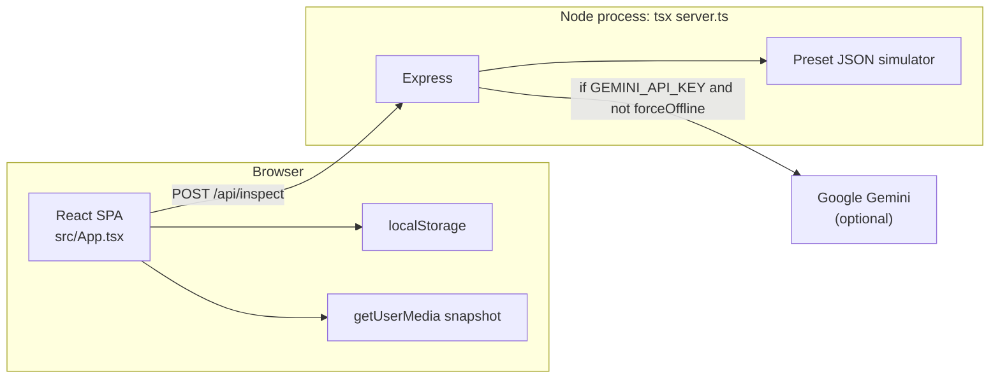

# PULSENET-ZERO

Browser demo for **optical quality-inspection UX** aimed at small-batch / micro-SME workshops (Seva Innovation Challenge 2026).

This repository is a **React 19 + Vite + Express** application. It can optionally send still images to **Google Gemini**. It does **not** currently implement ONNX Runtime Web, WebGPU inference, Three.js CAD, MQTT, WebXR, or a trained local detector.

For a full requirement-to-code audit, see [`PROJECT_AUDIT.md`](./PROJECT_AUDIT.md).

---

## Current implementation status

| Area | Status |
| --- | --- |
| Industrial-themed SPA (tabs, CRT overlay, PWA wiring) | Implemented in source |
| Webcam snapshot and image upload | Implemented in source (not browser-verified in the audit) |
| SVG demo “parts” with drawn defects | Implemented |
| `POST /api/inspect` simulation (preset JSON) | Implemented |
| `POST /api/inspect` Gemini vision | Code present; needs `GEMINI_API_KEY`; **not executed** in the audit |
| Local WASM / ONNX / WebGPU detection | **Not implemented** (UI labels only) |
| CAD (.STL / .OBJ / .STEP), Three.js | **Not implemented** |
| Model training / fine-tuning | **Not implemented** |
| MQTT / WebSockets / webhooks / PLC | **Not implemented** |
| Automated tests | **None** |
| Root license file | **None** (SPDX Apache-2.0 comment on `src/App.tsx` only) |

**Inference honesty:** “Offline / edge / Wasm / &lt;15 ms” results are **hardcoded or random numbers**, not measured on-device neural inference. Synthetic SVG defects are **not** equivalent to training a network.

---

## Problem statement and objectives

**Problem (product copy in the UI):** machine vision is expensive and data-hungry for micro-SMEs.

**What this repo actually delivers today:** a judge-facing demo console that:

- Walks through PASS / DEFECT / UNKNOWN screens using SVG fixtures.
- Optionally calls Gemini when a key is configured and offline mode is off.
- Stores a short inspection history in `localStorage`.

Proposal-level spatial CAD middleware remains **planned / unimplemented**.

---

## Features actually implemented

- Tabbed UI: Command Center, AI Inspection, Teach Model, Teach New Defect, Batch Analytics, Offline Mode, History (`src/App.tsx`).
- Procedural gear/flange SVGs and a preset library (`src/utils/partSVGs.ts`).
- Inspection workbench: preset inject, `image/*` upload, `getUserMedia` preview, JPEG snapshot, CSS “vision” filters, HUD grid, hardcoded caliper overlay, percentage bounding box from API `location` (`src/components/InspectionStudio.tsx`).
- Express APIs: `/api/status`, `/api/inspect`, `/api/teach-defect`, `/api/learned-defects` (`server.ts`).
- Client `localStorage` keys: `pnz_history`, `pnz_defects`, `pnz_ui_theme`, `pnz_console_overlay_config`.
- Web Audio pass/defect/alert/click cues (`src/utils/audio.ts`).
- PWA plugin config and icons under `public/` (`vite.config.ts`).
- Theme selector (neon / amber / emerald).
- CSV export of history metadata (`HistoryPage`).
- 16-step **cinematic** Judge Demo (`JudgeDemoWorkflow`) — it does **not** call the inspect API.

---

## Features partially implemented or planned

| Item | What exists | What does not |
| --- | --- | --- |
| Offline mode | UI toggle sets `forceOffline` | No local model; canned JSON |
| Teach model | Upload extra “golden” thumbnails | Uploads never affect inspect |
| Teach defect | Name added to in-memory / localStorage list | Reinspect is a timeout + 94% hardcode |
| Batch analytics | Charts from `INITIAL_BATCH` (labeled demo) | Not derived from live inspections |
| System telemetry | Animated GPU/FPS/WASM-heap **numbers** | Not from `performance` / WebGPU |
| Cloud inspection | Gemini JSON schema in `server.ts` | Model id and accuracy unverified |
| PWA | Manifest + Workbox static/font caching | Offline API/inference unverified |
| CAD privacy | Copy in Offline Mode page | Online path can send images to Google |

---

## Screenshots and demo

No screenshot assets are in the repo. To demo without a camera:

1. Start the server (see [Installation](#installation-and-setup)).
2. Open **AI Inspection**.
3. Click a **Test bench preset** (e.g. scratch or unknown).
4. Turn **OFFLINE** on, then **Run Inspection**.
5. For the scripted walkthrough, use **Judge Demo** in the navbar.

---

## Architecture



Dev mode: Express mounts Vite middleware (`server.ts`) so the UI and API share one origin and port.

---

## Technology stack

| Layer | Actual packages / files |
| --- | --- |
| UI | React 19, React DOM, lucide-react, motion, Tailwind CSS 4 (`@tailwindcss/vite`) |
| Bundler | Vite 8, `@vitejs/plugin-react`, `vite-plugin-pwa` |
| Server | Express 4, `tsx`, `dotenv` |
| Cloud AI | `@google/genai` (optional) |
| Language | TypeScript (noEmit via `tsc`) |
| Lockfile | `bun.lock` (Bun was **not** available on the audit machine; npm can still install from `package.json`) |

Not in `package.json`: ONNX Runtime, Three.js, MQTT clients, databases.

---

## Repository structure

```
.
├── server.ts              # Express + inspect/teach APIs
├── vite.config.ts         # Vite + PWA
├── package.json           # Scripts and dependencies (package name: "react-example")
├── bun.lock
├── index.html
├── metadata.json          # AI Studio metadata (camera + Gemini capability flags)
├── .env.example
├── PROJECT_AUDIT.md
├── README.md
├── public/                # PWA PNG/SVG icons
├── scripts/make-png.js    # Icon generator
└── src/
    ├── main.tsx
    ├── App.tsx
    ├── index.css
    ├── components/        # Pages and chrome
    ├── services/inspectionService.ts
    ├── types/inspection.ts
    ├── hooks/
    ├── context/
    └── utils/
```

---

## Prerequisites

- **Node.js** (audit machine: v24.19.0) and **npm** (audit machine: 11.17.0).
- Optional: **Bun** if you prefer `bun install` against `bun.lock` (CLI was not installed during the audit).
- Optional: a Google Gemini API key for the cloud inspect path.
- A Chromium-based browser for PWA install prompts; camera requires a secure context (HTTPS or localhost).

`node_modules` is gitignored and was **absent** after clone. You must install dependencies before `dev` / `build` / `lint`.

---

## Installation and setup

```bash
cd pulseNet-Zero
npm install
```

Copy environment placeholders (PowerShell):

```powershell
Copy-Item .env.example .env
```

POSIX:

```bash
cp .env.example .env
```

Edit `.env` locally. **Do not commit `.env`.** `.gitignore` already ignores `.env*`.

---

## Environment variable configuration

From `.env.example` and source:

| Variable | Required | Source of truth | Purpose |
| --- | --- | --- | --- |
| `GEMINI_API_KEY` | For cloud inspect only | `.env.example`, `server.ts` | If unset **or** `forceOffline` is true, `/api/inspect` returns canned JSON |
| `APP_URL` | No | `.env.example` only | **Not read** by application code |
| `PORT` | No | `server.ts` | HTTP port, default `3000` |
| `NODE_ENV` | No | `server.ts` | `production` serves `dist/` instead of Vite middleware |
| `DISABLE_HMR` | No | `vite.config.ts` | If `"true"`, Vite HMR/file watch off |

`.env.example` uses the placeholders `MY_GEMINI_API_KEY` and `MY_APP_URL`, not real credentials.

---

## How to run frontend and backend

One process serves both (Vite middleware in non-production):

```bash
npm run dev
```

Equivalent:

```bash
npm start
```

Both scripts are `"tsx server.ts"`. Listen address in code is `0.0.0.0` with `PORT` default **3000**:

`http://localhost:3000`

**Production-style** (inferred from `server.ts`; not run in the audit):

```bash
npm run build
```

Then start with `NODE_ENV=production` so Express serves `dist/`. `npm start` does **not** set `NODE_ENV` or run the build. If `dist` is missing in production mode, SPA routes will fail.

Preview the static Vite build only (no inspect API unless you also run Express):

```bash
npm run preview
```

---

## How to run tests and builds

Scripts in `package.json`:

| Script | Command | Notes |
| --- | --- | --- |
| `dev` / `start` | `tsx server.ts` | App server |
| `build` | `vite build` | Frontend production bundle + PWA |
| `preview` | `vite preview` | Vite static preview |
| `lint` | `tsc --noEmit` | Typecheck only (not ESLint) |
| `clean` | `rm -rf dist server.js` | Unix-style; may fail in Windows PowerShell |

There is **no** `test` script and **no** `*.test.*` / `*.spec.*` files.

```bash
npm run lint
npm run build
```

These were **not executed** in the audit because dependencies were not installed.

---

## How to use the application

1. **Command Center** — marketing/dashboard, fake resource monitor, launch inspection or Judge Demo.
2. **AI Inspection** — pick a preset or upload/capture, toggle Online/Offline, Run Inspection, read the result card.
3. **Teach Model** — view eight labeled “golden” SVGs; upload images into the grid only.
4. **Teach New Defect** — pick a class, Learn This Defect (POST name to API), Re-inspect (UI animation, not a new model).
5. **Batch Analytics** — demo lot `#PNZ-042` (explicit demo badge).
6. **Offline Mode** — sets the same `isOffline` flag; “edge benchmark” is a timeout + random 11–14 ms.
7. **History** — last records (seeded mocks until you inspect, then `localStorage`); CSV export.

Navbar **ONLINE/OFFLINE** is an application flag (`forceOffline`), not a guarantee of OS connectivity. `navigator.onLine` is shown separately on some widgets.

---

## Computer vision and inference workflow

```
Preset SVG | uploaded image | camera JPEG
        → InspectionService.inspectPart()
        → POST /api/inspect { imageBase64, partProfile, forceOffline, simulatedPreset, knownDefects }
        → A or B
```

**A — Simulation (when `forceOffline` is true OR `GEMINI_API_KEY` is missing):**

- Does not inspect pixels.
- `simulatedPreset`: `normal` | `scratch` | `crack` | `dent` | `unknown` from the **currently selected demo part’s `condition`**.
- Returns fixed status, scores, observations, and box.
- `processingTimeMs` = wall clock **plus** a random 9–13 ms (`server.ts`).
- `processingEngine` string claims Wasm even though none ran.

**B — Gemini (key present and not forced offline):**

- Strips `data:` URL, sends `inlineData` to `ai.models.generateContent` with model **`gemini-3.8-flash`**.
- Asks the model for PASS/DEFECT/UNKNOWN JSON, a box, and **simulated** Ra/runout/contour strings.
- On exception, the server still responds **200** with **PASS** (see audit AUDIT-002).

**Client fallback:** if `fetch` throws, `inspectionService.ts` invents another canned record labeled `Browser Wasm Edge Kernel`.

**Overlays:** CSS box using `location.{x,y,width,height}` as percentages. Teach-defect page uses a **fixed** box (`38%`, `48%`, …).

There is **no** tensor layout to match against an ONNX graph; no model files are in the repo.

---

## Model acquisition or configuration

- **No local `.onnx` / weights to download.**
- Cloud: set `GEMINI_API_KEY` in `.env`. Whether `gemini-3.8-flash` is a valid Gemini model id was **not verified**.
- “Learned defects” are a name list in process memory (server) and `localStorage` (client), not model weights.

---

## API documentation

No authentication. JSON bodies. Inspect accepts up to **50 MB** JSON (`express.json({ limit: '50mb' })`).

### `GET /api/status`

Returns `status`, `engine`, `geminiAvailable` (boolean from key presence), `model`, `edgeLatencyTarget`, `learnedDefectsCount`, `activeProfile`, `goldenSamplesLoaded`. Several fields are constants.

### `POST /api/inspect`

Body fields used: `imageBase64`, `partProfile` (default `'Precision Gear'`), `knownDefects`, `forceOffline`, `simulatedPreset`.

Response fields include `status`, `defectType`, `confidence`, `anomalyScore`, `location`, `observations`, `processingTimeMs`, `processingEngine`, `metrics`.

### `POST /api/teach-defect`

Requires `defectName`. Optional `category`, `sampleImage` (accepted, **not stored**). Mutates an in-memory array; lost on process restart.

### `GET /api/learned-defects`

Returns that in-memory array (seeded with three demo names).

SPA routes are handled by Vite in development, or `dist/index.html` in production.

---

## Offline execution and browser compatibility

- **PWA:** `vite-plugin-pwa` `registerType: 'autoUpdate'`, Workbox `globPatterns` for js/css/html/ico/png/svg/fonts, plus CacheFirst for Google Fonts.
- **Not fully offline CV:** inspect still calls `/api/inspect`. A downed server yields the **client canned fallback**, not a local neural net.
- **Fonts:** `index.html` loads Google Fonts on first visit.
- **Camera:** `facingMode: 'environment'`, `playsInline`, `muted`. Compatibility **not tested** here.
- **Install UI:** `PWAInstallButton` + `usePWAInstall`.

---

## Security, privacy, and data handling

- Do not put real keys in git. `.env.example` is placeholders only.
- **Online inspect sends the image to Google** when a key is set. Treat camera frames and uploads as leaving the device.
- APIs have **no login**. The server listens on **`0.0.0.0`**. Prefer firewall/bind restrictions for any shared machine.
- History in `localStorage` can include data URLs (`imageUrl`) — large and device-local; not a secure store.
- Server-side learned defects are not durable and are not access-controlled.

Details: [`PROJECT_AUDIT.md`](./PROJECT_AUDIT.md) §9.

---

## Known limitations and outstanding issues

High-priority items from the audit:

- **AUDIT-001 (P0):** Unauthenticated 50 MB inspect/teach on `0.0.0.0`; optional Gemini proxy of images.
- **AUDIT-002 (P1):** Gemini errors returned as PASS.
- **AUDIT-003 (P1):** Offline inspect follows the last SVG preset, not the uploaded/camera pixels.
- **AUDIT-004 (P1):** WASM/WebGPU/sub-15 ms claims do not match the code.
- **AUDIT-005 (P1):** Teach reinspect is scripted.

Also: no tests; `clean` uses `rm -rf`; package name is `react-example`; analytics are demo data.

---

## Troubleshooting

| Symptom | Likely cause | What to do |
| --- | --- | --- |
| `tsx` / Vite not found | No `npm install` | Run `npm install` |
| `bun` command missing | Bun not installed | Use npm, or install Bun to use `bun.lock` |
| Always simulated results | No `GEMINI_API_KEY` or Offline on | Expected; see inference section |
| Upload still flagged as scratch | Preset condition still `SCRATCH` | Known AUDIT-003 |
| Camera denied | Permission / non-secure origin | Use localhost HTTPS/http as allowed by the browser |
| `npm start` blank in production | `NODE_ENV=production` without `npm run build` | Build `dist` first |
| `npm run clean` fails on Windows | `rm -rf` | Delete `dist` manually |
| False PASS with a key configured | Gemini throw path | See AUDIT-002; check server logs (do not print the key) |

---

## Future improvements

Aligned with the proposal, in order:

1. Stop presenting simulation as edge inference; fail closed on AI errors.
2. Real on-device model (e.g. ONNX Runtime Web) **or** keep Gemini but label it.
3. Bind inspect to pixels for uploads/camera.
4. Auth, loopback bind, body limits, explicit cloud consent.
5. Tests for `/api/inspect` simulation matrix and UI overlay.
6. Only then: CAD/Three.js, spatial calibration, MQTT/webhooks.

---

## Contribution

No `CONTRIBUTING` file. Practical notes:

- Keep secrets out of git.
- Do not add dependencies that execute network inference without documenting cloud vs local.
- `npm run lint` is `tsc --noEmit`.

---

## License

`src/App.tsx` includes `SPDX-License-Identifier: Apache-2.0`. There is **no** `LICENSE` file and **no** `license` field in `package.json`. Confirm with the project owners before redistribution.
